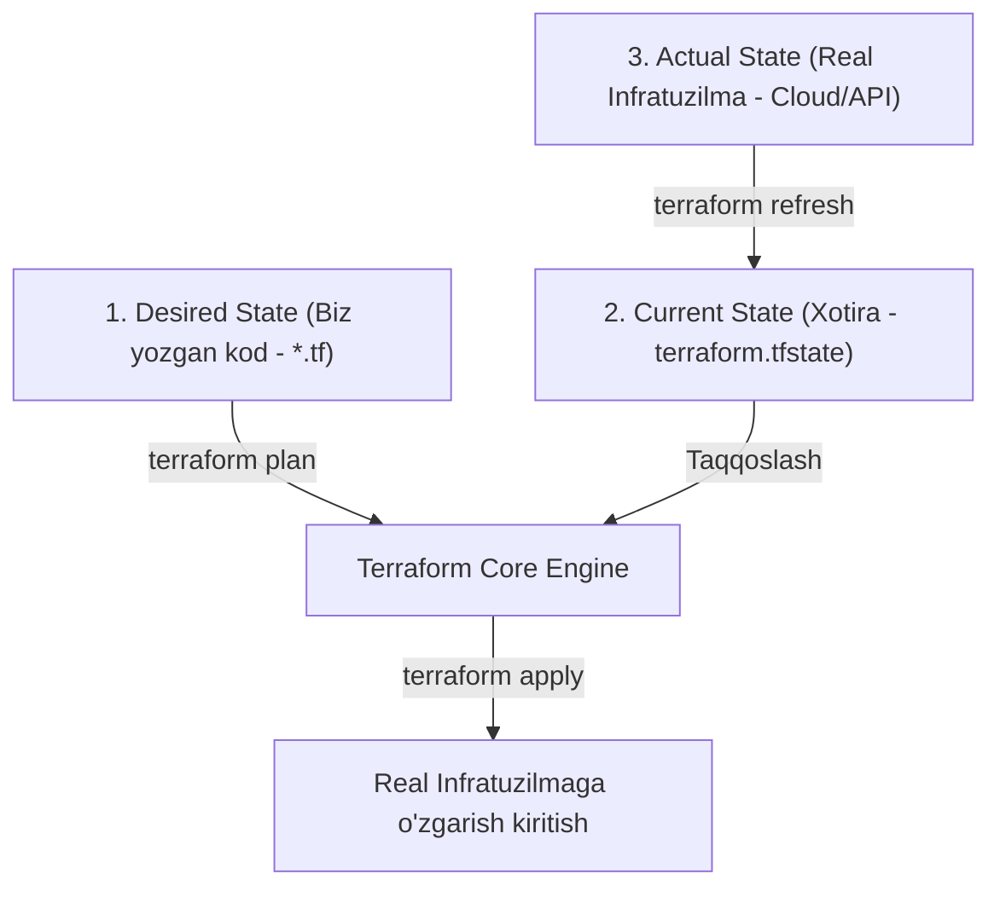

# Day 2: Terraformning Umumiy Logikasi & Asosiy Terminlar (Terms of Terraform)

Ushbu darsda biz Terraform qanday ishlashining umumiy mantiqiy zanjirini (Overall Architecture & Logic) hamda Terraformda uchraydigan barcha asosiy tushuncha va terminlarni (**Terms**) misollar yordamida tahlil qilamiz. Hali katta loyiha qilmaymiz — maqsad har bir termin talabaning miyasiga mustahkam o'rnashishi!

---

## 🧠 1-Qism: Terraformning Umumiy Logikasi (Overall Logic)

Terraformning butun falsafasi **3 ta holat (State)** o'rtasidagi farqni topish va ularni tenglashtirishga asoslangan:



### Bu 3 ta holat nima?
1. **Desired State (Xohlanayotgan holat):** Siz `.tf` fayllarda yozgan kod. Masalan: *"Menga 2 ta server kerak"*.
2. **Current State (Terraform bilgan holat):** `terraform.tfstate` faylidagi yozuvlar. Terraform oxirgi marta nima yaratganini shu yerdan biladi.
3. **Actual State (Haqiqiy holat):** AWS, Azure yoki sizning kompyuteringizda ayni daqiqada mavjud bo'lgan real holat.

> **Terraformning bosh vazifasi:**  
> Haqiqiy holatni (Actual State) siz yozgan kodga (Desired State) aynan moslashtirish! Agar server yo'q bo'lsa yaratadi, agar o'zgartirilgan bo'lsa to'g'irlaydi, agar koddan o'chirib tashlangan bo'lsa — yo'q qiladi.

---

### ⚙️ Terraform Arxitekturasi qanday tuzilgan?
Terraform ikkita asosiy qismdan iborat:
- **Terraform Core:** Terraformning "miyasi". U buyruqlarni qabul qiladi, kodni tahlil qiladi, resurslar o'rtasidagi bog'liqliklar grafigini (*Dependency Graph*) chizadi va nima qilish kerakligini rejalashtiradi.
- **Providers (Plaginlar):** Terraformning "qo'llari". Core har bir bulutning (AWS, Azure, Docker) ichki API tilini bilmaydi. Provayderlar esa Terraform Core buyruqlarini tegishli servisning API so'rovlariga aylantirib beradi.

---

## 📚 2-Qism: Terraformning Asosiy Terminlari (Core Terms)

Quyida Terraformda har kuni ishlatiladigan 10 ta asosiy termin va ularning jonli kod misollari keltirilgan:

---

### 1. Provider (Provayder)
* **Ma'nosi:** Terraform qaysi servis yoki platforma bilan gaplashishini belgilovchi drayver / plagin.
* **Tushunish uchun o'xshatish:** Kompyuteringizga printer ulasangiz, u ishlashi uchun maxsus drayver kerak bo'ladi. Provider — bu Terraform uchun bulutning drayveri.
* **Misol:**
```hcl
# AWS bilan ishlash uchun provayder sozlamasi
provider "aws" {
  region = "us-east-1"
}

# Docker bilan ishlash uchun provayder sozlamasi
provider "docker" {
  host = "npipe:////./pipe/docker_engine"
}
```

---

### 2. Resource (Resurs)
* **Ma'nosi:** Terraform orqali yaratiladigan, o'zgartiriladigan va boshqariladigan **eng asosiy obyekt** (infratuzilma g'ishti). Bu virtual mashina, tarmoq, S3 bucket, fayl yoki DNS yozuvi bo'lishi mumkin.
* **Sintaksisi:** `resource "<provider_turi>_<resurs_nomi>" "<ichki_nom>"`
* **Misol:**
```hcl
# AWS'da bitta EC2 server yaratish resursi
resource "aws_instance" "my_web_server" {
  ami           = "ami-0c55b159cbfafe1f0"
  instance_type = "t2.micro"

  tags = {
    Name = "Web-Server-01"
  }
}
```
> **Eslatma:** `aws_instance` — bu resurs turi, `my_web_server` esa bu resursga o'zimiz kod ichida murojaat qilishimiz uchun berilgan shaxsiy nomimiz (label).

---

### 3. Data Source (Ma'lumotlar Manbasi)
* **Ma'nosi:** Terraform orqali yangi narsa **yaratmasdan**, mavjud bo'lgan infratuzilma haqidagi ma'lumotlarni o'qib olish (faqat Read-Only).
* **Tushunish uchun o'xshatish:** Google'dan qidiruv berib ma'lumot topish kabi.
* **Misol:**
```hcl
# AWS'dagi eng so'nggi rasmiy Ubuntu 22.04 imidjining ID raqamini qidirib topish
data "aws_ami" "ubuntu" {
  most_recent = true
  owners      = ["099720109477"] # Canonical kompaniyasi IDsi

  filter {
    name   = "name"
    values = ["ubuntu/images/hvm-ssd/ubuntu-jammy-22.04-amd64-server-*"]
  }
}
```

---

### 4. Variable / Input Variable (Kiritish O'zgaruvchisi)
* **Ma'nosi:** Kodni dinamik va moslashuvchan qilish uchun tashqaridan uzatiladigan parametrlar. Kod ichida qiymatlarni qattiq yozib qo'ymaslik (*hardcode qilmaslik*) uchun ishlatiladi.
* **Tushunish uchun o'xshatish:** Funksiyaga beriladigan argumentlar `function(x, y)`.
* **Misol:**
```hcl
# variables.tf faylida e'lon qilinadi:
variable "server_port" {
  description = "Veb-server eshitadigan port"
  type        = number
  default     = 8080
}

variable "environment" {
  description = "Muhit turi (dev, staging, prod)"
  type        = string
  default     = "dev"
}
```

---

### 5. Output / Output Values (Chiqish Qiymatlari)
* **Ma'nosi:** Terraform resursni yaratib bo'lgach, terminalda bizga ko'rsatishi yoki boshqa modullarga uzatishi kerak bo'lgan natijaviy ma'lumotlar (masalan, serverning ochiq IP manzili, DB paroli yoki resurs IDsi).
* **Tushunish uchun o'xshatish:** Funksiyaning `return` qiymati.
* **Misol:**
```hcl
# outputs.tf faylida:
output "server_ip_manzili" {
  description = "Yaratilgan serverning ochiq IP manzili"
  value       = aws_instance.my_web_server.public_ip
}
```

---

### 6. Local / Local Values (Ichki Hisoblangan Qiymatlar)
* **Ma'nosi:** Faqat joriy modul ichida qayta-qayta ishlatiladigan, hisoblangan yoki birlashtirilgan oraliq o'zgaruvchilar. Tashqaridan o'zgartirib bo'lmaydi.
* **Tushunish uchun o'xshatish:** Dasturlash tilidagi oddiy ichki o'zgaruvchi (`const fullName = firstName + " " + lastName;`).
* **Misol:**
```hcl
locals {
  service_name = "billing-api"
  owner        = "DevOps-Team"

  # Bir nechta qiymatni birlashtirish
  common_tags = {
    Service     = local.service_name
    Owner       = local.owner
    Environment = var.environment
  }
}
```

---

### 7. State & State File (`terraform.tfstate`)
* **Ma'nosi:** Terraform yaratgan resurslarning real dunyodagi IDlari, sozlamalari va bog'liqliklari yozib boriladigan JSON formatidagi maxsus ma'lumotlar bazasi (xotira fayli).
* **Muhim qoida:** Bu faylni hech qachon qo'lda tahrirlash mumkin emas! U yo'qolsa, Terraform o'zi yaratgan serverlarni "unutib" qo'yadi.
* **Tarkibi (namuna):**
```json
{
  "version": 4,
  "terraform_version": "1.7.0",
  "resources": [
    {
      "mode": "managed",
      "type": "aws_instance",
      "name": "my_web_server",
      "instances": [
        {
          "attributes": {
            "id": "i-0a123b456c789def0",
            "public_ip": "54.210.12.89"
          }
        }
      ]
    }
  ]
}
```

---

### 8. Module (Modul)
* **Ma'nosi:** Bitta vazifani bajaruvchi bir nechta Terraform fayllarining (`main.tf`, `variables.tf`, `outputs.tf`) jamlanmasi. Kodni qayta ishlatish (*reusability*) va tartibli saqlash uchun xizmat qiladi.
* **Tushunish uchun o'xshatish:** Tayyor kutubxona yoki paket (masalan, Python'dagi `import module`).
* **Misol:**
```hcl
# Tayyor VPC modulini chaqirib ishlatish
module "my_vpc" {
  source  = "terraform-aws-modules/vpc/aws"
  version = "5.0.0"

  name = "asosiy-tarmoq"
  cidr = "10.0.0.0/16"
}
```

---

### 9. Backend
* **Ma'nosi:** `terraform.tfstate` fayli qayerda saqlanishini belgilovchi konfiguratsiya. 
* Standart holatda u sizning kompyuteringizda (`local`) saqlanadi. Jamoaviy ishlashda esa xavfsiz markaziy joyda (masalan, AWS S3 bucket, Azure Blob Storage yoki HashiCorp Terraform Cloud) saqlanishi shart.
* **Misol:**
```hcl
terraform {
  backend "s3" {
    bucket = "bizning-kompaniya-tfstate"
    key    = "prod/terraform.tfstate"
    region = "us-east-1"
  }
}
```

---

### 10. Provisioner (Provizioner)
* **Ma'nosi:** Resurs yaratilgandan yoki o'chirilgandan so'ng uning ichida skript yurgizish (masalan, `remote-exec` orqali SSH bilan buyruq yurgizish yoki `local-exec` orqali lokal kompyuterda buyruq bajarish).
* > [!WARNING]
  > HashiCorp Provisionerlarni **eng so'nggi chora (Last Resort)** sifatida ishlatishni tavsiya qiladi. Server ichini sozlash uchun Ansible, Cloud-Init yoki Packer ishlatgan ma'qul.
* **Misol:**
```hcl
resource "null_resource" "example" {
  provisioner "local-exec" {
    command = "echo Server yaratildi: ${aws_instance.my_web_server.id} >> log.txt"
  }
}
```

---

## 🗺 3-Qism: Terminlarning O'zaro Bog'liqlik Xaritasi

Talabalar uchun bu terminlarning bitta fayl ichida bir-biri bilan qanday ishlashini tasavvur qilish oson bo'lishi uchun quyidagi qisqa sxemaga qarang:

$$\text{Variable (Kiruvchi)} \longrightarrow \text{Local (Qayta ishlovchi)} \longrightarrow \text{Resource / Data (Yaratuvchi)} \longrightarrow \text{Output (Chiquvchi)}$$

1. **Variables** orqali tashqaridan ma'lumot kiradi (`var.env = "prod"`).
2. **Locals** orqali ular birlashtiriladi (`local.name = "company-prod-vm"`).
3. **Data Source** orqali mavjud imidj IDsi olinadi (`data.aws_ami.ubuntu.id`).
4. **Provider** ko'rsatmasi bo'yicha **Resource** yaratiladi (`resource "aws_instance"`).
5. Natija **State** fayliga yoziladi va **Output** orqali ekranga chiqariladi (`output "ip"`).

---

## 📝 Xulosa va Keyingi Qadam
Bugun biz barcha poydevor terminlar bilan tanishdik. Hech qanday murakkab kod yo'q — barchasi mantiqiy bloklardan iborat. 
Endi ushbu terminlar bitta kod namunasida qanday ko'rinishini ko'rish uchun **[Lab 02 (Sintaksis Laboratoriyasi)](../lab/README.md)**ga o'ting!
