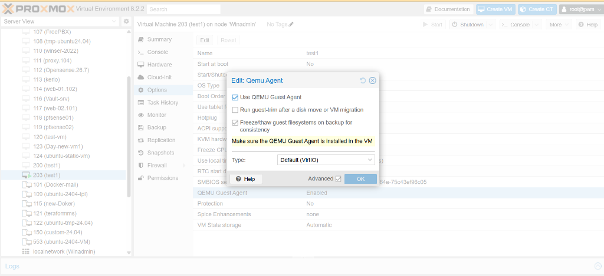
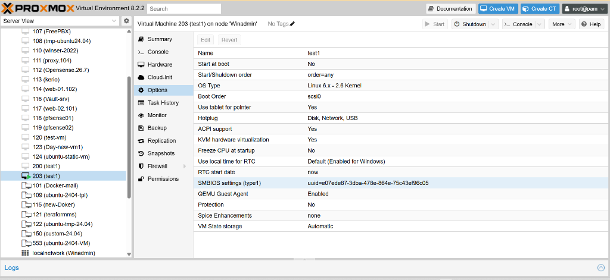

# Day 3: Oddiy ISO orqali VM o'rnatib, uni Cloud-Init Template qilish (Lab 03-C)

> **Mavzu:** Yangi VM'dan Cloud-Init Shablon (Template) tayyorlash: 0 dan to'liq amaliy qo'llanma  
> **Misoldagi parametrlar:** VM ID: `9000`, Nomi: `ubuntu-2404-tpl`, Storage: `local-lvm`, Bridge: `wan_br`  
> *(Sizning Proxmox muhitingizdagi nomlar/ID boshqacha bo'lsa, mos ravishda almashtiring)*

---

## 📑 Mundarija

1. [Nega aynan ISO orqali Template yaratiladi?](#-nega-aynan-iso-orqali-template-yaratiladi)
2. [1-bosqich: Proxmox GUI orqali VM yaratish](#-1-bosqich-proxmox-gui-orqali-vm-yaratish)
3. [2-bosqich: QEMU Guest Agentni Proxmox GUI'da yoqish (Rasmlar bilan)](#-2-bosqich-qemu-guest-agentni-proxmox-guida-yoqish-rasmlar-bilan)
4. [3-bosqich: Ubuntu Server'ni ISO orqali o'rnatish](#-3-bosqich-ubuntu-serverni-iso-orqali-ornatish)
5. [4-bosqich: VM ichida paketlar va QEMU Agentni sozlash](#-4-bosqich-vm-ichida-paketlar-va-qemu-agentni-sozlash)
6. [5-bosqich: Tozalash — Golden Image holatiga keltirish (ENG MUHIM)](#-5-bosqich-tozalash--golden-image-holatiga-keltirish-eng-muhim)
7. [6-bosqich: Proxmox Host'da Cloud-Init drayverini ulash va sozlash](#-6-bosqich-proxmox-hostda-cloud-init-drayverini-ulash-va-sozlash)
8. [7-bosqich: Tekshirish va Shablonga (Template) aylantirish](#-7-bosqich-tekshirish-va-shablonga-template-aylantirish)
9. [8-bosqich: Sinab ko'rish (Clone & Test)](#-8-bosqich-sinab-korish-clone--test)
10. [Muhim eslatmalar va Senior DevOps maslahatlari](#-muhim-eslatmalar-va-senior-devops-maslahatlari)

---

## 🎯 Nega aynan ISO orqali Template yaratiladi?

1-usulda biz rasmiy Cloud tasvir (`.img`) orqali template yaratgan edik. Ammo ko'p hollarda kompaniyalarda:
- Maxsus dasturlar, korporativ xavfsizlik agentlari yoki sertifikatlar oldindan o'rnatilgan bo'lishi kerak;
- Tizim diski partitsiyalari (masalan, LVM hajmlari) qo'lda maxsus taqsimlanishi lozim;
- Internetga to'g'ridan-to'g'ri chiqish cheklangan (Air-gapped) serverlarda faqat lokal ISO fayli bo'ladi.

Bunday holatda **oddiy Ubuntu ISO orqali toza VM o'rnatib, unga Cloud-Init va QEMU Guest Agent kiritib, so'ng template qilish** yagona professional yo'l hisoblanadi.

---

## 🖥 1-bosqich: Proxmox GUI orqali VM yaratish

Proxmox veb interfeysida yuqori o'ng burchakdagi ko'k **"Create VM"** tugmasini bosing va quyidagi sozlamalarni kiriting:

| Bo'lim (Tab) | Sozlama parametri | Tavsiya etilgan qiymat | Tavsif |
|:---|:---|:---|:---|
| **General** | **Node** | `Winadmin` *(sizning node)* | VM joylashadigan jismoniy server |
| | **VM ID** | `9000` | Shablon uchun maxsus ID (masalan: 9000) |
| | **Name** | `ubuntu-2404-tpl` | Shablon nomi |
| **OS** | **Storage** | `local` (yoki ISO saqlangan joy) | ISO fayl joylashgan saqlagich |
| | **ISO Image** | `ubuntu-24.04.x-live-server-amd64.iso` | Ubuntu rasmiy server ISO fayli |
| | **Type / Version** | `Linux` / `6.x - 2.6 Kernel` | Tizim yadrosi |
| **System** | **Qemu Agent** | **[x] Belgilang (Enabled)** | **Juda muhim!** Quyida batafsil tushuntirilgan |
| | **Graphic card** | `Default` | Standart video drayver |
| | **SCSI Controller** | `VirtIO SCSI` | Eng yuqori tezlikdagi disk kontrolleri |
| **Disks** | **Bus / Device** | `SCSI` : `0` | Disk shinasi |
| | **Storage** | `local-lvm` | Disk saqlanadigan pool |
| | **Disk size (GiB)**| `20` GB | Bazaviy hajm (klonlanganda osongina kattalashtiriladi) |
| **CPU** | **Sockets / Cores**| `1` soket / `2` cores | 2 ta yadro |
| | **Type** | `host` (yoki `x86-64-v2-AES`) | Protsessor optimizatsiyasi |
| **Memory** | **Memory (MiB)** | `2048` MB | 2 GB operativ xotira |
| **Network** | **Bridge** | `wan_br` (yoki `vmbr0`) | Serveringizdagi tarmoq bridge interfeysi |
| | **Model** | `VirtIO (paravirtualized)` | Eng tezkor virtual tarmoq kartasi |

> [!CAUTION]
> **Muhim:** Yakuniy oynada **"Start after created"** katagiga **belgi qo'ymang**. Avval **Finish** bosing, VM yaratilsin, lekin uni hali yoqmang!

---

## 🔌 2-bosqich: QEMU Guest Agentni Proxmox GUI'da yoqish (Rasmlar bilan)

Agar siz 1-bosqichda "System" tabida QEMU Agentni yoqishni unutgan bo'lsangiz yoki mavjud VM sozlamalarini tekshirmoqchi bo'lsangiz, uni Proxmox GUI orqali quyidagicha yoqasiz:

### 📸 2.1. QEMU Agentni tahrirlash oynasi:
1. Chap daraxtsimon menyudan VM'ingizni tanlang (masalan, `203 (test1)` yoki `9000 (ubuntu-2404-tpl)`).
2. O'rta menyudan **Options** bo'limiga o'ting.
3. Ro'yxatdan **QEMU Guest Agent** qatorini toping va unga sichqoncha bilan 2 marta bosing (yoki yuqoridagi **Edit** tugmasini bosing).
4. Quyidagi oyna ochiladi:


*(Rasm fayli: [qemu-agent-modal-edit.png](file:///c:/Users/user/Documents/terraform/day-3/images/qemu-agent-modal-edit.png))*

Ushbu oynada quyidagi parametrlarni o'rnating:
- **[x] Use QEMU Guest Agent:** Katakka qushcha (check) qo'ying.
- **[x] Freeze/thaw guest filesystems on backup for consistency:** Zaxira nusxa (backup) olayotganda ma'lumotlar yaxlitligini ta'minlash uchun belgilang.
- **Type:** `Default (VirtIO)` qilib qoldiring.
- **OK** tugmasini bosing.

---

### 📸 2.2. Options ro'yxatida faollashtirilgan holat:
O'zgarish saqlangach, **Options** bo'limida **QEMU Guest Agent** holati **`Enabled`** bo'lib ko'rinishi shart:


*(Rasm fayli: [qemu-agent-options-enabled.png](file:///c:/Users/user/Documents/terraform/day-3/images/qemu-agent-options-enabled.png))*

---

### 🧠 Nega QEMU Guest Agent Proxmox va Terraform uchun HAYOTIY MUHIM?

| Funksiya | Agent YOQILGAN bo'lsa (`Enabled`) | Agent O'CHIRILGAN bo'lsa (`Disabled`) |
|:---|:---|:---|
| **IP manzilini ko'rish** | Proxmox GUI **Summary** panelida VM ning haqiqiy IPv4/IPv6 manzillari bir necha soniyada chiqadi. | Proxmox IP manzilini ko'ra olmaydi (`No QEMU guest agent installed` deb turadi). |
| **Terraform ishlashi** | Terraform yangi VM yaratganda IP manzilini agent orqali bilib oladi va keyingi bosqichlarga o'tadi. | Terraform `waiting for IP address...` xatosi bilan timeout berib yiqiladi. |
| **O'chirish (Shutdown)** | Gipervizor VM ichidagi `systemctl poweroff` ni toza chaqiradi (*Graceful Shutdown*). | ACPI orqali o'chirishga harakat qiladi yoki majburiy tokdan uzadi (*Hard Poweroff*). |
| **Fayllarni zaxiralash (Backup)** | Proxmox diskdagi keshni to'liq diskka yozdirib, fayl tizimini xavfsiz muzlatadi (*FS Freeze/Thaw*). | Backup vaqtida yozilayotgan ma'lumotlar buzilish (corruption) xavfi bo'ladi. |

> [!WARNING]
> **Proxmoxning oltin qoidasi:**  
> Agar VM ishlab turgan paytda GUI orqali QEMU Agentni `Enabled` qilsangiz, u **darhol ishlamaydi**. KVM gipervizor jarayoni maxsus virtio-soketni ochishi uchun VM ni to'liq **Shutdown** (o'chirish) qilib, so'ng qayta **Start** qilish shart! (Oddiy Reboot yetarli bo'lmaydi).

---

## 💿 3-bosqich: Ubuntu Server'ni ISO orqali o'rnatish

Endi VM'ni yoqing (**Start** bosing) va **Console** bo'limiga kiring:

1. **Language / Keyboard:** O'zingizga qulay til va klaviaturani tanlang (`English`).
2. **Network connections:** Standart `DHCP` qoldiring (o'rnatish vaqtida paketlarni yangilash uchun internet kerak).
3. **Configure proxy / Ubuntu mirror:** Standart qoldiring (Enter).
4. **Storage configuration:**
   - Butun diskdan foydalanishni tanlang (`Use an entire disk`);
   - Standart LVM guruhi tanlangan bo'ladi — davom eting (Done).
5. **Profile setup (Foydalanuvchi):**
   - **Your name:** `admin` (yoki ixtiyoriy)
   - **Server's name:** `ubuntu-2404-tpl`
   - **Pick a username:** `admin` *(Tavsiya: vaqtinchalik userni ham darhol `admin` deb nomlang, shunda keyinchalik uni o'chirishga hojat qolmaydi)*
   - **Password:** O'zingiz bilgan sinov paroli
6. **SSH Setup:**
   - **[x] Install OpenSSH server** — albatta belgilang (Space tugmasi bilan)!
7. **Featured Server Snaps:** Hech qanday qo'shimcha paket tanlamang (Docker, Nextcloud va h.k. kerak emas, template sof bo'lishi shart).
8. O'rnatish tugagach **Reboot Now** tugmasi chiqadi.
9. Agar ekranda *"Please remove the installation medium, then press ENTER"* chiqsa, shunchaki **Enter** bosing.

---

## 📦 4-bosqich: VM ichida paketlar va QEMU Agentni sozlash

VM qayta yoqilgach, konsol orqali yoki SSH bilan kiring (`ssh admin@<VM_IP>`):

### 1. Tizimni yangilash va QEMU Agent hamda Cloud-Init o'rnatish:
```bash
sudo apt update && sudo apt full-upgrade -y
sudo apt install -y cloud-init qemu-guest-agent
```

### 2. QEMU Guest Agent xizmatini yoqish va tekshirish:
```bash
sudo systemctl enable --now qemu-guest-agent
sudo systemctl status qemu-guest-agent --no-pager
```
*(Holati `active (running)` bo'lishi shart).*

### 3. SSH orqali parol bilan kirishga ruxsat berish (Ixtiyoriy, lekin laboratoriya uchun qulay):
Agar siz SSH kalitdan tashqari parol bilan ham kirmoqchi bo'lsangiz:
```bash
echo 'ssh_pwauth: true' | sudo tee /etc/cloud/cloud.cfg.d/99-pwauth.cfg
```

### 4. Kundalik zarur DevOps vositalarini oldindan o'rnatish:
Yangi VM'lar ochilganda har safar bularni o'rnatib o'tirmaslik uchun hozir o'rnating:
```bash
sudo apt install -y curl wget vim htop net-tools sudo
```

---

## 🧹 5-bosqich: Tozalash — Golden Image holatiga keltirish (ENG MUHIM)

> [!CAUTION]
> **DIQQAT: Eng ko'p xatolik shu bosqichda qilinadi!**  
> Ubuntu Live Server o'rnatilgandan so'ng tizim ichida Cloud-Init'ni bloklovchi fayllar va o'zining unikal `machine-id` identifikatorini qoldiradi. Agar ularni tozalamasangiz, ushbu shablondan klonlangan VMlarda Cloud-Init ishlamaydi va tarmoqda IP to'qnashuvi yuzaga keladi.

VM ichida konsolda quyidagi buyruqlarni birma-bir bajaring:

### 1. Ubuntu installer qoldiqlarini va Cloud-Init blokirovkasini tozalash:
```bash
# Cloud-init ni bloklab qo'ygan fayllarni o'chirish:
sudo rm -f /etc/cloud/cloud-init.disabled
sudo rm -f /etc/cloud/cloud.cfg.d/99-installer.cfg
sudo rm -f /etc/cloud/cloud.cfg.d/subiquity-disable-cloudinit-networking.cfg

# Installer yaratgan statik tarmoq konfiguratsiyasini tozalash:
sudo rm -f /etc/netplan/00-installer-config.yaml
sudo rm -f /etc/netplan/50-cloud-init.yaml
```

### 2. Proxmox NoCloud ma'lumotlar manbasini kiritish:
Cloud-init birinchi navbatda Proxmox virtual CD-ROM drayverini qidirishi uchun:
```bash
echo "datasource_list: [ NoCloud, ConfigDrive ]" | sudo tee /etc/cloud/cloud.cfg.d/99-pve.cfg
```

### 3. VM'ning unikal identifikatorlarini (Machine-ID va SSH kalitlarini) tozalash:
```bash
# Cloud-init loglari va keshini tozalash
sudo cloud-init clean --logs --seed

# Machine-ID ni nollash (har bir klonlangan yangi VM o'zining yangi unikal ID sini oladi)
sudo truncate -s 0 /etc/machine-id
sudo rm -f /var/lib/dbus/machine-id
sudo ln -s /etc/machine-id /var/lib/dbus/machine-id

# Eski SSH host kalitlarini o'chirish (klonlangan VM o'zining yangi kalitini generatsiya qiladi)
sudo rm -f /etc/ssh/ssh_host_*

# Apt keshini tozalash
sudo apt clean

# Bash buyruqlar tarixini o'chirish va VMni to'xtatish:
cat /dev/null > ~/.bash_history && history -c
sudo shutdown -h now
```

> [!IMPORTANT]
> **QAT'IY QOIDA:**  
> `sudo shutdown -h now` buyrug'idan so'ng **ushbu VM'ni boshqa hech qachon yoqmang!**  
> Agar uni adashib yana yoqsangiz, Linux o'chirilgan `machine-id` va `ssh_host_*` kalitlarini qayta yaratadi hamda 5-bosqichdagi barcha tozalash amallarini qaytadan bajarishingizga to'g'ri keladi.

---

## ⚙️ 6-bosqich: Proxmox Host'da Cloud-Init drayverini ulash va sozlash

Endi **Proxmox Host Shell** konsoliga (yoki SSH orqali Proxmox gipervizoriga) o'ting.

### 1. VM to'xtaganini tekshiring:
```bash
qm status 9000
```
Natija `status: stopped` bo'lishi shart.

### 2. Disklar, Cloud-Init va Agent parametrlarini sozlash:
```bash
# 1. Eski ISO o'rnatish CD-ROM diskini slotdan chiqarib tashlash:
qm set 9000 --delete ide2

# 2. Yangi Cloud-Init virtual konfiguratsiya drayverini ide2 ga ulash:
qm set 9000 --ide2 local-lvm:cloudinit

# 3. Yuklanish tartibida faqat asosiy scsi0 diski birinchi turishini belgilash:
qm set 9000 --boot order=scsi0

# 4. QEMU Guest Agent va Proxmox Serial konsolini faollashtirish:
qm set 9000 --agent enabled=1
qm set 9000 --serial0 socket

# 5. Standart foydalanuvchi, parol va tarmoqni ko'rsatish:
qm set 9000 --ciuser admin --cipassword 'KuchliParol123!'
qm set 9000 --ipconfig0 ip=dhcp
```

*(Eslatma: Agar sizda asosiy disk `scsi0` emas, `sata0` yoki `virtio0` bo'lsa, `qm config 9000` orqali tekshirib, shunga mos yozing).*

---

## 🔍 7-bosqich: Tekshirish va Shablonga (Template) aylantirish

Konfiguratsiya to'g'riligini tekshiramiz:

```bash
qm config 9000 | grep -E "name|ide2|boot|serial|ciuser|ipconfig|agent"
```

### Kutilayotgan to'g'ri natija:
```text
agent: enabled=1
boot: order=scsi0
ciuser: admin
ide2: local-lvm:vm-9000-cloudinit,media=cdrom
ipconfig0: ip=dhcp
name: ubuntu-2404-tpl
serial0: socket
```

Agar barcha qatorlar joyida bo'lsa, VM'ni rasmiy o'zgarmas Shablonga (Template) aylantiramiz:

```bash
qm template 9000
```

> 🎉 **Tabriklaymiz!** Proxmox GUI da 9000 raqamli VM belgisi kompyuter ikonkasi o'rniga **shablon (qog'oz varag'i) ikonkasiga** aylanadi.

---

## 🚀 8-bosqich: Sinab ko'rish (Clone & Test)

Yaratilgan shablonning 100% ishlashini sinab ko'ramiz. Proxmox host shell'da buyruq bering:

```bash
# 1. Shablon asosida yangi VM (ID: 200, Nomi: test1) klonlash:
qm clone 9000 200 --name test1 --full

# 2. Yangi VMni ishga tushirish:
qm start 200
```

### Natijani tekshirish:
1. 30-40 soniya kuting.
2. Proxmox GUI'da `200 (test1)` ustiga bosing -> **Summary** sahifasini oching.
3. QEMU Guest Agent ishlagani sababli, **IPs** qatorida routeringiz bergan haqiqiy IP manzil ko'rinadi (masalan: `192.168.1.150`).
4. SSH orqali ulaning:
   ```bash
   ssh admin@<IP_MANZILI>
   ```
   Parol: `KuchliParol123!` (yoki shablonga kiritilgan kalit).

---

## 🛠 Keyingi VM'lar uchun tezkor amallar

Ushbu shablondan istalgan vaqtda yangi serverlar ochishingiz va ularning parametrlarini o'zgartirishingiz mumkin:

```bash
# Yangi VM klonlash:
qm clone 9000 205 --name app-server-01 --full

# Unga statik IP va Gateway belgilash:
qm set 205 --ipconfig0 ip=192.168.1.75/24,gw=192.168.1.1

# SSH ochiq kalitingizni kiritish:
qm set 205 --sshkeys ~/.ssh/id_rsa.pub

# Diskini qo'shimcha 30 GB ga kengaytirish:
qm resize 205 scsi0 +30G

# Ishga tushirish:
qm start 205
```

---

## 💡 Muhim eslatmalar va Senior DevOps maslahatlari

1. **Template'ni to'g'ridan-to'g'ri yoqib bo'lmaydi:**  
   Proxmox shablonga aylantirilgan VM'ni yoqishga ruxsat bermaydi. Agar dasturlarni yangilamoqchi bo'lsangiz:
   - Shablonni yangi VM qilib klonlang;
   - Uni yoqib, kerakli yangilanishlarni o'rnating;
   - 5-bosqichdagi tozalash amallarini qayta bajaring;
   - Yangi ID bilan yangi template qiling.

2. **Parol xavfsizligi:**  
   `--cipassword 'OddiyParol'` faqat sinov va laboratoriya uchun. Haqiqiy ishlab chiqarish (production) infratuzilmasida parolsiz kirish uchun doimo **SSH Public Key** (`--sshkeys /root/.ssh/id_rsa.pub`) parametrini ishlating.

3. **Eski foydalanuvchi qoldiqlari:**  
   Agar siz OS o'rnatayotganda userni `sarvar` deb ochib, keyinchalik Cloud-Init orqali `ciuser: admin` bergan bo'lsangiz, VM ichida `sarvar` ham saqlanib qoladi.
   Shuning uchun eng toza usul: Ubuntu ISO o'rnatish jarayonida ham asosiy foydalanuvchi nomini `admin` (yoki kompaniyangiz standartiga ko'ra `ubuntu`) deb oching!
