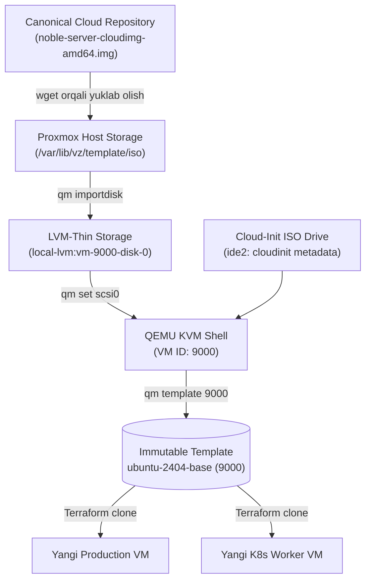

# Day 3: Cloud-Init Minimal Template Yaratish (Lecture 03-A)

Ushbu ma'ruzada rasmiy Ubuntu 24.04 LTS (Noble Numbat) Cloud tasviri yordamida Proxmox VE uchun toza va minimal Cloud-Init andozasini (Template) tayyorlashning nazariy asoslari, arxitekturasi hamda barcha qadamlarda ishlatiladigan buyruqlarning texnik mohiyati tahlil qilinadi.

---

## 🎯 Darsning Asosiy Maqsadi

- Nega an'anaviy operatsion tizim o'rnatish usuli (ISO orqali grafik/matnli o'rnatish) avtomatlashtirishga to'g'ri kelmasligini tushunish.
- Cloud Image va Cloud-Init texnologiyalarining o'zaro ishlash mexanizmini o'rganish.
- Proxmox VE dagi `qm` (QEMU Machine Manager) utilitasi va uning drayverlarini (VirtIO, SCSI, Serial Console, CloudInit) chuqur tahlil qilish.
- Proxmoxda klonlash uchun xavfsiz va o'zgarmas (immutable) bazaviy shablon (Template) yaratish logikasini o'zlashtirish.

---

## 🧠 1-Qism: Nazariy Asoslar & Arxitektura

### 1. Nega an'anaviy ISO emas, balki Cloud Image?

Odatda operatsion tizimni o'rnatishda `.iso` fayli yuklab olinadi va VM ishga tushirilib, klaviatura orqali til, foydalanuvchi nomi, parol, disk qismlari belgilanadi. Bu jarayon:
- Inson omiliga tayanadi (qo'lda bosish talab etiladi);
- Sekin (har bir VM uchun 10–20 daqiqa vaqt ketadi);
- Terraform kabi IaC (Infrastructure as Code) vositalari orqali avtomatlashtirish imkonsiz.

**Cloud Image (Bulutli Tasvir):**
Canonical (Ubuntu), RedHat, Debian va boshqa Linux distributivlari tomonidan oldindan o'rnatilgan, siqilgan va optimallashtirilgan sof tizim tasviri (`.img` yoki `.qcow2`). 
Unda hech qanday foydalanuvchi paroli yo'q, faqat birinchi yoqilishida maxsus buyruqlarni kutuvchi **Cloud-Init** agenti mavjud.

---

### 2. Proxmox Storage Tizimi va `pvesm`

Proxmox serverida bir nechta xotira hovuzlari (Storage Pools) mavjud:
1. **Faylli saqlagichlar (File-level Storage - `local` yoki `dir`):** ISO tasvirlar, backup fayllar va shablonlar oddiy fayl ko'rinishida saqlanadi (masalan, `/var/lib/vz/template/iso`).
2. **Blokli saqlagichlar (Block-level Storage - `local-lvm` yoki `local-zfs`):** Virtual mashinalarning qattiq disklari saqlanadi. Ular tezkor, *Thin Provisioning* (faqat yozilgan hajm qadar joy egallash) va tezkor snapshot (oniy ko'chirma) imkoniyatini beradi.

Storage holatini tekshirish uchun **`pvesm` (Proxmox VE Storage Manager)** buyrug'i ishlatiladi.

---

### 3. Proxmox Uskuna Sozlamalari (Hardware Configuration)

Nega VM sozlamalarida standart variantlar emas, maxsus drayverlar tanlanadi?

#### A) CPU Turi: `--cpu host`
- Standart `kvm64` emulyatori zamonaviy protsessorlarning ko'plab buyruqlar to'plamini (AES-NI, AVX, SSE4) virtual mashinaga o'tkazmaydi.
- `--cpu host` sozlamasi serveringizdagi jismoniy protsessorning barcha imkoniyatlarini (flags) to'g'ridan-to'g'ri VM ichiga uzatadi. Bu ma'lumotlar bazalari, shifrlash (HTTPS/SSL) va Kubernetes uchun 15-30% yuqori tezlik beradi.

#### B) Disk Drayveri: `--scsihw virtio-scsi-pci` va `--scsi0`
- Eski `ide` yoki `sata` drayverlari emulyatsiyaga tayanadi va sekin ishlaydi.
- `VirtIO-SCSI-PCI` — KVM virtualizatsiyasidagi eng tezkor, past kechikishli (low-latency) va eng ko'p funksiyaga ega drayver. U **TRIM/Discard** (o'chirilgan fayllar o'rnini storage'ga qaytarish) va minglab I/O navbatlarini qo'llab-quvvatlaydi.

#### C) Cloud-Init Drayveri: `--ide2 local-lvm:cloudinit`
- Cloud-Init tizimiga konfiguratsiyani (IP manzil, hostname, SSH kalitlar) uzatish uchun Proxmox kichik virtual CD-ROM drayverini yaratadi.
- Ushbu virtual CD-ROM odatda `ide2` shinasiga ulanadi, chunki BIOS/UEFI uni darhol CD drayver deb taniydi va operatsion tizim yuklanishidan oldin parametrlarni o'qiydi.

#### D) Serial Konsol: `--serial0 socket --vga serial0`
- Ubuntu Cloud tasvirlarida standart grafik muhit (GUI) yoki standart VGA terminal drayveri sukut bo'yicha yoqilmagan bo'lishi mumkin.
- Serial konsol orqali Proxmox veb-interfeysidagi qulay **xterm.js** terminali ishlaydi: matnni nusxalash, sichqoncha bilan belgilash va tarmoq uzilib qolgan taqdirda ham to'g'ridan-to'g'ri konsol orqali boshqarish mumkin bo'ladi.

#### E) QEMU Guest Agent: `--agent enabled=1`
- VM ichidagi operatsion tizim bilan Proxmox gipervizori o'rtasidagi aloqa ko'prigi.
- **Nega o'ta muhim?** Terraform VM yaratgach, uning IP manzilini bilishi kerak. Agar Agent yoqilmagan bo'lsa, Proxmox VMning ichki IP manzilini bila olmaydi va Terraform `outputs` qiymatida bo'sh joy qaytaradi yoki xato beradi!

---

## 📋 2-Qism: Buyruqlar Tahlili va "Nega Kerak?" Tushuntirishlari

Quyidagi jadvalda Minimal Template (ID: 9000) yaratishda ishlatiladigan har bir buyruqning vazifasi va sababi keltirilgan:

| # | Buyruq | Nega kerak? (Sababi) | Tavsifi (Description) |
| :--- | :--- | :--- | :--- |
| **1** | `pvesm status` | Proxmoxda qaysi storage'lar faol ekanligini aniqlash | Barcha ulangan xotira hovuzlari (masalan `local`, `local-lvm`) ro'yxatini va ularning statusini ko'rsatadi. |
| **2** | `cd /var/lib/vz/template/iso` | Tasvirlar saqlanadigan standart katalogga o'tish | Proxmoxda ISO va raw tasvirlar uchun ajratilgan xavfsiz va tizimli joyga o'tadi. |
| **3** | `wget -O ubuntu-2404-cloud.img <URL>` | Canonical rasmiy serveridan eng yangi Ubuntu 24.04 tasvirini yuklab olish | Cloud Image faylini yuklab oladi va uni tushunarli nom bilan saqlaydi. |
| **4** | `qm create 9000 ...` | Bo'sh VM karkasini yaratish | Proxmox bazasida 9000 raqamli yangi virtual mashina profilini vCPU, RAM va tarmoq kartasi bilan ochadi. |
| **5** | `qm importdisk 9000 <img_file> local-lvm` | Yuklab olingan `.img` faylni Proxmox LVM-thin diskiga aylantirish | Oddiy fayl ko'rinishidagi diskni Proxmoxning blokli saqlagichiga virtual disk qilib ko'chiradi. |
| **6** | `qm set 9000 --scsihw virtio-scsi-pci --scsi0 local-lvm:vm-9000-disk-0` | Import qilingan diskni virtual mashinaga tizim diski sifatida ulash | Diskni tezkor VirtIO SCSI kontrolleriga `scsi0` asosiy diski sifatida ulaydi. |
| **7** | `qm set 9000 --ide2 local-lvm:cloudinit` | Cloud-Init konfiguratsiya drayverini biriktirish | Proxmoxga ushbu VM uchun IP, SSH kalit kabi ma'lumotlarni uzatuvchi virtual CD-ROM drayverini qo'shadi. |
| **8** | `qm set 9000 --boot c --bootdisk scsi0` | VM birinchi bo'lib qaysi diskdan yuklanishini belgilash | Tizim yuklanganda tarmoqdan yoki CD'dan emas, to'g'ridan-to'g'ri `scsi0` asosiy diskidan yuklanishini ta'minlaydi. |
| **9** | `qm set 9000 --serial0 socket --vga serial0` | Tizimga seriyali konsolni ulash | Veb-interfeysdagi xterm.js terminali orqali tezkor va qulay matnli konsolni ishga tushiradi. |
| **10**| `qm set 9000 --agent enabled=1` | QEMU Guest Agent bilan aloqa kanalini ochish | Proxmox va Terraform VM'ning ichki tarmoq IP manzillarini aniqlashi uchun soketni yoqadi. |
| **11**| `qm set 9000 --ciuser "sarvar" --cipassword "..." --sshkeys /root/.ssh/id_rsa.pub --ipconfig0 ip=dhcp` | Cloud-Init orqali login, parol, SSH kalit va tarmoqni sozlash | VM ishga tushganda unga kirish uchun maxsus foydalanuvchi hisobi, parol, SSH ochiq kaliti va DHCP tarmog'ini avtomatik sozlaydi. |
| **12**| `qm template 9000` | Oddiy VMni o'zgarmas Shablonga (Template) aylantirish | VMni yoqib bo'lmaydigan, faqat nusxa (klon) olinadigan andozaga aylantiradi. |

---

## 🔍 3-Qism: Parametrlar Chuqur Tahlili

Keling, `qm create` va `qm set` buyruqlarining parametrlarini tahlil qilamiz:

### `qm create 9000`
- `--name "ubuntu-2404-base"`: Proxmox interfeysida ko'rinadigan shablon nomi.
- `--memory 2048`: Boshlang'ich operativ xotira (2 GB). Shablon uchun 2 GB yetarli, klonlash vaqtida Terraform orqali xohlagancha o'zgartiriladi.
- `--cores 2`: Virtual protsessor yadrolari soni (2 yadro).
- `--cpu host`: Server protsessorining barcha ko'rsatmalarini to'liq uzatish.
- `--net0 virtio,bridge=vmbr0`: Birinchi tarmoq interfeysi (`net0`). `virtio` — Linux uchun eng tezkor paravirtual drayver. `vmbr0` — Proxmoxning standart Linux Bridge virtual tarmog'i.

### `qm set 9000` (Cloud-Init sozlamalari)
- `--ciuser "sarvar"`: Yangi yaratiladigan standart tizim foydalanuvchisi.
- `--cipassword "..."`: Foydalanuvchi paroli (Proxmox uni xavfsiz xeshlab saqlaydi).
- `--sshkeys /root/.ssh/id_rsa.pub`: VM ichidagi `~/.ssh/authorized_keys` ga qo'shiladigan SSH ochiq kaliti.
- `--ipconfig0 ip=dhcp`: Birinchi tarmoq interfeysiga DHCP orqali avtomatik IP olish buyrug'i.

---

## ⚖️ 1-Usulning (Minimal) Afzalliklari va Cheklovlari

### ✅ Afzalliklari:
1. **Toza va xavfsiz:** Tasvir ichiga hech narsa qo'lda yozilmagan, Canonical original tasdiqlagan holatda.
2. **Yengil hajm:** Proxmox storage'ida minimal joy egallaydi (~600 MB).
3. **Tez yaratiladi:** Qo'shimcha paketlar o'rnatishni kutmasdan, 1-2 daqiqada tayyor bo'ladi.

### ⚠️ Cheklovlari:
1. `qemu-guest-agent` rasmiy tasvirda sukut bo'yicha o'rnatilmagan yoki yoqilmagan bo'lishi mumkin. Natijada birinchi yuklanishda Terraform IP manzilni darhol ko'ra olmasligi ehtimoli bor.
2. Har bir yangi VM yoqilganda internet orqali `apt update` va paketlarni qaytadan yuklab olishiga to'g'ri keladi (agar internet sekin bo'lsa, VM deploy qilish cho'ziladi).

> [!TIP]
> Agar sizga serverlar zudlik bilan, barcha kerakli utilitalar (`qemu-guest-agent`, `curl`, `htop`, Toshkent vaqti) o'rnatilgan holda 10 soniyada ishga tushishi kerak bo'lsa — **[2-Usul: virt-customize orqali Custom Template](./02-cloud-init-custom-template.md)** ma'ruzasini ko'rib chiqing!
