# Day 3: virt-customize orqali Custom Template Yaratish (Lecture 03-B)

Ushbu ma'ruzada ishlab chiqarish (Production) va DevOps muhitida keng qo'llaniladigan **"Pre-baked Golden Image"** konsepsiyasi, `virt-customize` utilitasi yordamida Linux diskini tizimni yoqmasdan turib (offline) o'zgartirish texnologiyasi hamda uning buyruqlari tahlil qilinadi.

---

## 🎯 Darsning Asosiy Maqsadi

- **Pre-baking vs Boot-time Provisioning:** Dasturiy ta'minotni oldindan tasvir ichiga joylash (*Bake*) va VM yoqilayotganda o'rnatish (*Bootstrap*) o'rtasidagi farqni tushunish.
- `libguestfs` kutubxonasi va `virt-customize` mexanizmi qanday ishlashini o'rganish.
- QEMU Guest Agentning Proxmox va Terraform bilan o'zaro ishlashidagi o'ta muhim rolini anglash.
- Server loglari va monitoringi uchun to'g'ri Timezone (`Asia/Tashkent`) o'rnatilishining texnik sabablarini bilish.

---

## 🧠 1-Qism: Nazariy Asoslar & "Golden Image" Falsafasi

### 1. Muammo: Nega faqat minimal tasvirning o'zi yetarli emas?

Agar biz faqat 1-usuldagi minimal tasvirni ishlatsak:
1. Yangi VM yaratilganda, unga har safar `qemu-guest-agent`, `curl`, `htop` kabi standart utilitalar kerak bo'ladi.
2. Agar bularni VM yoqilgandan keyin o'rnatmoqchi bo'lsak:
   - Har bir yangi VM Canonical serverlariga ulanib `apt update` qilishi kerak (tashqi internet trafigi sarflanadi).
   - Agar internet sekin bo'lsa yoki repository vaqtincha ishlamay qolsa, Terraform deployment xatolik bilan to'xtab qoladi.
   - 10 ta VM yaratilsa, 10 martalab bir xil paketlar yuklab olinadi va server ishga tushishi bir necha daqiqaga cho'ziladi.

```mermaid
graph TD
    subgraph "A) Boot-time Provisioning (Sekin & Tavakkalli)"
        M1[Minimal Template] -->|Klonlash: 10s| VM1[Yangi VM]
        VM1 -->|Birinchi yuklanish| B1["apt update && apt install qemu-guest-agent curl... (1-3 daqiqa)"]
        B1 -->|Internet sekin bo'lsa| ERR[Xatolik / Timeout]
    end

    subgraph "B) Golden Image / Pre-baking (Tezkor & Barqaror)"
        IMG[Original Cloud Img] -->|virt-customize offline| CUST[Custom Golden Image]
        CUST -->|qm template 9100| TPL[(Custom Template 9100)]
        TPL -->|Terraform klonlash: 10s| VM2[Yangi VM]
        VM2 -->|Birinchi yuklanish: 5s| READY["To'liq tayyor: Agent, Paketlar, Tashkent Vaqti! 🎉"]
    end
```



---

### 2. `virt-customize` Texnologiyasi Qanday Ishlaydi?

`virt-customize` — bu Red Hat kompaniyasining ochiq kodli **`libguestfs-tools`** to'plamiga kiruvchi o'ta kuchli utilitadir.

**Uning sehri nimada?**
- Odatda biror Linux tizimiga paket o'rnatish uchun uni yoqish (boot qilish), tarmoqqa ulash va SSH orqali kirish kerak.
- `virt-customize` esa **virtual mashinani yoqmasdan (OFFLINE holatda)**, disk tasvirining (`.img` / `.qcow2`) ichki qismlarini (partitions) o'qiy oladi.
- U xavfsiz vaqtinchalik mikro-qobiqda fayl tizimini (masalan, `ext4`) o'rnatadi (`chroot`), paketlarni to'g'ridan-to'g'ri ichiga yozadi, konfiguratsiya fayllarini tahrirlaydi va xavfsiz yopadi.
- Natijada bir necha soniya ichida sizda barcha dasturlari o'rnatilgan tayyor disk paydo bo'ladi!

---

### 3. O'rnatiladigan Komponentlar Nega Tanlangan?

| Komponent / Sozlama | Nega aynan u tanlandi? |
| :--- | :--- |
| **`qemu-guest-agent`** | Proxmox hypervisoriga VM ning ichki holatini, xususan IP manzilini xabar qilib turadi. Terraform aynan shu orqali VM qaysi IP olganini biladi. Shuningdek, toza o'chirish (*graceful shutdown*) va buyruqlar yuborish imkonini beradi. |
| **`curl` & `wget`** | DevOps olamidagi eng birlamchi vositalar. Har qanday Docker, Kubernetes, script yoki sertifikatlarni yuklab olishda zarur. |
| **`htop`** | Serverning CPU, RAM, jarayonlar (processes) yuklamasini qulay va rangli grafikda monitoring qilish vositasi. |
| **`net-tools`** | Klassik tarmoq vositalari (`ifconfig`, `netstat`, `route`). Tarmoq muammolarini zudlik bilan tahlil qilish uchun. |
| **`sudo`** | Administrator ruxsatlarini xavfsiz boshqarish tizimi. |
| **`timezone Asia/Tashkent`** | Serverdagi barcha jurnallar (logs), cron rejalari va monitoring hodisalari O'zbekiston mahalliy vaqti bilan yozilishi uchun. Aks holda loglar UTC'da bo'lib, nosozliklarni tekshirishda chalkashlik keltirib chiqaradi. |
| **`PermitRootLogin yes`** | Laboratoriya va sinov muhitida serverga root huquqi bilan to'g'ridan-to'g'ri va tezkor ulanish imkoniyatini ta'minlash. |

---

## 📋 2-Qism: Buyruqlar Tahlili va "Nega Kerak?" Tushuntirishlari

Quyidagi jadvalda Custom Template (ID: 9100) yaratishda ishlatiladigan har bir buyruqning vazifasi va sababi keltirilgan:

| # | Buyruq | Nega kerak? (Sababi) | Tavsifi (Description) |
| :--- | :--- | :--- | :--- |
| **1** | `apt update && apt install -y libguestfs-tools` | Disk tasvirlarini offline tahrirlash uchun kerakli dasturlar to'plamini o'rnatish | Proxmox hostiga `virt-customize`, `virt-edit`, `guestfish` utilitalarini o'rnatadi. |
| **2** | `cp ubuntu-2404-cloud.img ubuntu-2404-custom.img` | Original toza tasvirni buzmasdan, o'zgartirishlar uchun alohida nusxa yaratish | Minimal bazaviy tasvirni saqlab qoladi va custom modifikatsiya uchun yangi fayl tayyorlaydi. |
| **3** | `virt-customize -a ubuntu-2404-custom.img ...` | Virtual mashinani yoqmasdan uning ichiga dasturlar va sozlamalarni kiritish | Disk ichiga kirib paketlarni o'rnatadi, vaqt mintaqasini o'zgartiradi va xizmatlarni faollashtiradi. |
| **4** | `qm create 9100 ...` | Custom shablon uchun alohida VM karkasini ochish (ID: 9100) | Proxmoxda 9100 raqami ostida yangi apparat profilini ro'yxatga oladi. |
| **5** | `qm importdisk 9100 ubuntu-2404-custom.img local-lvm` | Tayyorlangan custom diskni Proxmox saqlagichiga ko'chirish | O'zgartirilgan `.img` faylini `local-lvm` blok saqlagichiga `vm-9100-disk-0` qilib import qiladi. |
| **6** | `qm set 9100 --scsihw virtio-scsi-pci --scsi0 local-lvm:vm-9100-disk-0` | Import qilingan custom diskni tizimga asosiy disk sifatida ulash | Diskni eng tezkor VirtIO SCSI shinasiga `scsi0` qilib biriktiradi. |
| **7** | `qm set 9100 --ide2 local-lvm:cloudinit` | Cloud-Init konfiguratsiya CD-ROM drayverini qo'shish | Klonlash vaqtida IP va SSH kalitlarini qabul qiluvchi drayverni o'rnatadi. |
| **8** | `qm set 9100 --boot c --bootdisk scsi0` | Asosiy yuklanish qurilmasi qilib `scsi0` diskini ko'rsatish | VM yoqilganda to'g'ridan-to'g'ri operatsion tizim joylashgan diskdan yuklanishini ta'minlaydi. |
| **9** | `qm set 9100 --serial0 socket --vga serial0` | Tizimga seriyali konsolni faollashtirish | Veb-interfeysdagi xterm.js qulay matnli konsoli ishlashi uchun serial port ulaydi. |
| **10**| `qm set 9100 --agent enabled=1` | Gipervizor va QEMU Guest Agent o'rtasidagi aloqa soketini yoqish | VM ichidagi `qemu-guest-agent` bilan Proxmox o'rtasida ma'lumot almashinuvini ta'minlaydi. |
| **11**| `qm template 9100` | Tayyor VMni o'zgarmas Shablonga (Template) aylantirish | VMni klonlash uchun xavfsiz va tahrirlanmas andoza holatiga keltiradi. |

---

## 🔍 3-Qism: `virt-customize` Argumentlarining Chuqur Tahlili

Keling, eng muhim buyruqning argumentlarini alohida tahlil qilamiz:

```bash
virt-customize -a ubuntu-2404-custom.img \
  --install qemu-guest-agent,curl,wget,htop,net-tools,sudo \
  --timezone "Asia/Tashkent" \
  --run-command "systemctl enable qemu-guest-agent" \
  --run-command "sed -i 's/#PermitRootLogin prohibit-password/PermitRootLogin yes/' /etc/ssh/sshd_config" \
  --update
```

- **`-a ubuntu-2404-custom.img` (Add image):** Qaysi disk fayli ustida operatsiya bajarilishini ko'rsatadi.
- **`--install <paketlar>`:** Tizim ichida `apt-get install -y` buyrug'ini ishga tushirib, ko'rsatilgan barcha paketlarni diskka yozadi.
- **`--timezone "Asia/Tashkent"`:** `/etc/timezone` va `/etc/localtime` fayllarini Toshkent vaqtiga (`UTC+5`) simvolik havola (symlink) qiladi.
- **`--run-command "systemctl enable qemu-guest-agent"`:** Tizim yuklanganda QEMU agenti avtomatik ravishda xizmat sifatida ishga tushishini sozlaydi (`symlink to multi-user.target`).
- **`--run-command "sed -i ... /etc/ssh/sshd_config"`:** SSH server konfiguratsiyasidagi `PermitRootLogin` satrini qidirib, unga `yes` qiymatini o'rnatadi.
- **`--update`:** Tizim ichidagi barcha mavjud paketlarni oxirgi xavfsizlik yangilanishlariga (`apt-get upgrade`) ko'taradi.

---

## 📊 Yakuniy Taqqoslash: 9000 vs 9100

| Xususiyati | 1-Usul: Minimal (ID: 9000) | 2-Usul: Custom (ID: 9100) |
| :--- | :--- | :--- |
| **Tasvir manbasi** | Sof Canonical Ubuntu 24.04 tasviri | O'zgartirilgan Golden Image |
| **Tayyorlash vaqti** | 1-2 daqiqa | 3-5 daqiqa (paketlar yuklanishi sabab) |
| **Disk hajmi** | ~600-700 MB | ~1.2-1.5 GB |
| **QEMU Agent holati** | O'rnatilmagan yoki nofaol | Oldindan o'rnatilgan va faollashtirilgan |
| **Vaqt mintaqasi (Timezone)** | Standart UTC | O'zbekiston (`Asia/Tashkent`) |
| **Terraform deploy tezligi** | Sekinroq (qo'shimcha o'rnatishlar kerak) | O'ta tez (10-15 soniyada tayyor) |
| **Tavsiya etiladigan soha** | Sinov va minimal konteyner muhitlari | **Production, DevOps va Kubernetes klasterlari** |

> [!IMPORTANT]
> Real DevOps loyihalarida aynan **2-usul (Custom Template - 9100)** tavsiya etiladi. Chunki u Terraform bilan 100% ishonchli ishlaydi va har bir VM ishga tushishi bilan darhol uning IP manzili aniqlanadi!
