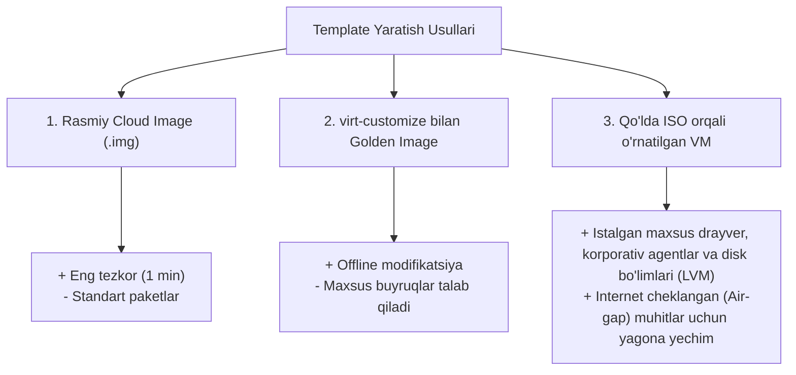
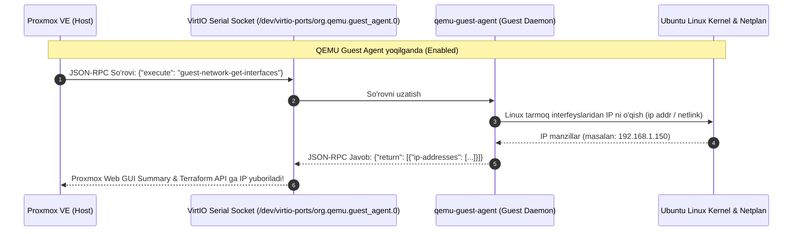
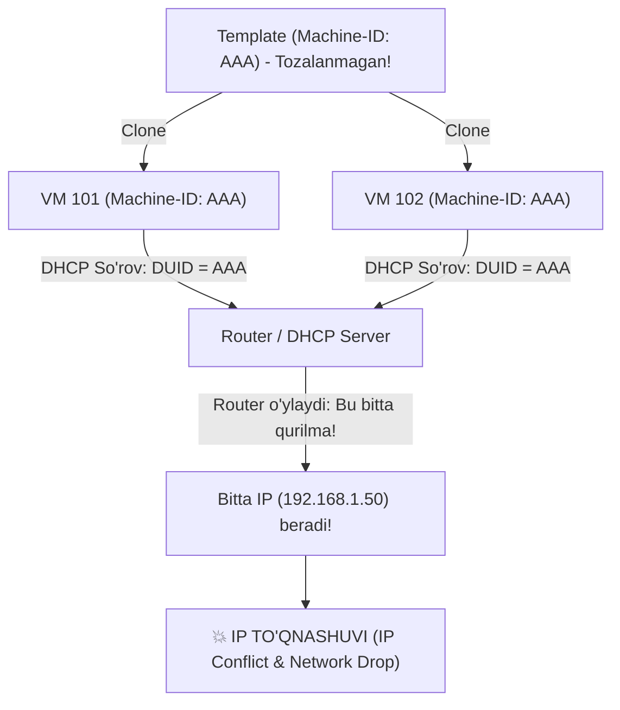

# Day 3: Custom ISO orqali VM'dan Cloud-Init Template Yaratish Nazariyasi (Lecture 03-C)

Ushbu ma'ruzada Ubuntu Server ISO tasviridan foydalanib o'rnatilgan virtual mashinani (VM) ishlab chiqarish (Production) darajasidagi **Cloud-Init Golden Template**ga aylantirishning ichki mexanizmlari, Subiquity installerining Cloud-Init'ni bloklash sabablari, Machine-ID nollashning ahamiyati hamda **QEMU Guest Agent**ning arxitekturaviy roli chuqur tahlil qilinadi.

---

## 🎯 Darsning Asosiy Maqsadi

- **ISO vs Cloud-Image:** Qachon ISO orqali template tayyorlash afzalligini anglash;
- **Subiquity bloki:** Ubuntu Live Server o'rnatuvchisi nima uchun `/etc/cloud/cloud-init.disabled` faylini yaratishini va uni qanday yechishni bilish;
- **Machine-ID & DHCP zanjiri:** Bir xil machine-id ning tarmoq to'qnashuvlariga (IP Conflict) olib kelish mexanizmini tushunish;
- **QEMU Guest Agent chuqur tahlili:** Gipervizor va Guest OS o'rtasidagi VirtIO aloqa soketi qanday ishlashi va Terraform nima sababdan usiz IP topa olmasligini o'rganish;
- Proxmox GUI va CLI orqali to'g'ri template tayyorlash qoidalarini o'zlashtirish.

---

## 🧠 1-Qism: Nega aynan ISO orqali Template?

Cloud tasvirlar (`.img`) juda qulay va tez, ammo real ishlab chiqarish infratuzilmasida ISO orqali shablon yaratishga to'g'ri keladigan holatlar ko'p:



---

## 🔌 2-Qism: QEMU Guest Agent Arxitekturasi va Muhimligi

Proxmox gipervizori VM tashqarisida turadi. KVM gipervizori VM xotirasidagi tarmoq interfeyslari yoki dasturlarning ichki holatini bevosita bilmaydi.

### Aloqa mexanizmi:


### Agar QEMU Guest Agent yoqilmasa nima bo'ladi?
1. **Terraform Timeout:** Terraform `proxmox_vm_qemu` resursi yangi VM yaratgach, uning IP manzilini kutadi (`waiting for IP`). Agent bo'lmasa, Terraform 10-15 daqiqa kutib `Error: timeout waiting for IP address` xatosi bilan yiqiladi.
2. **IP Ko'rinmaydi:** Proxmox Summary oynasida `IPs: No QEMU guest agent installed` yozuvi turadi.
3. **Hard Shutdown xavfi:** Serverni o'chirish buyrug'i berilganda, gipervizor ACPI signal yuboradi. Agar tizim javob bermasa, majburiy tokdan uzadi (Poweroff) — bu esa ma'lumotlar yo'qolishiga olib kelishi mumkin.

### 📸 Proxmox GUI orqali QEMU Agentni yoqish:


*(Rasm: [qemu-agent-modal-edit.png](file:///c:/Users/user/Documents/terraform/day-3/images/qemu-agent-modal-edit.png) - VM -> Options -> QEMU Guest Agent tahrirlash oynasi)*


*(Rasm: [qemu-agent-options-enabled.png](file:///c:/Users/user/Documents/terraform/day-3/images/qemu-agent-options-enabled.png) - QEMU Guest Agent muvaffaqiyatli yoqilgan holat)*

---

## 🚫 3-Qism: Nega Ubuntu ISO'dan yaratilgan VM'da Cloud-Init ishlamay qoladi?

Oddiy Ubuntu Server ISO o'rnatganda, uning installer dasturi (**Subiquity**) o'rnatish yakunida quyidagi faylni hosil qiladi:

```text
/etc/cloud/cloud-init.disabled
```

### Subiquity nima uchun buni qiladi?
- Ubuntu Server ISO o'rnatuvchisi o'ylaydiki: *"Foydalanuvchi til, tarmoq va foydalanuvchini qo'lda kiritdi. Shu sababli keyingi yuklanishlarda Cloud-Init qayta ishga tushib, bu sozlamalarni buzmasligi kerak"*.
- Shu sababli u Cloud-Init'ni butunlay **muzlatib (disable qilib)** qo'yadi.
- Agar ushbu fayl o'chirilmasa, siz Proxmoxda qancha `ciuser` yoki `ipconfig0` bermang — **Cloud-Init ularni o'qimaydi!**

---

## 🆔 4-Qism: Machine-ID va DHCP to'qnashuvi fojiasi

Har bir zamonaviy Linux tizimi o'rnatilganda `/etc/machine-id` faylida 32 belgili unikal hesh yaratiladi (masalan: `b24a9d70104e46059...`).



### To'g'ri yechim:
Template qilishdan oldin:
```bash
sudo truncate -s 0 /etc/machine-id
sudo rm -f /var/lib/dbus/machine-id
sudo ln -s /etc/machine-id /var/lib/dbus/machine-id
```
Buning natijasida har bir yangi klonlangan VM birinchi yuklanishida `systemd` orqali **o'zining yangi unikal ID**sini generatsiya qiladi va routerdan mustaqil IP oladi!

---

## 📌 Xulosa va Amaliyotga Yo'naltirish

ISO orqali shablon tayyorlash 7 ta mantiqiy qadamdan iborat:
1. **VM yaratish:** QEMU Agent, SCSI disk va VirtIO tarmoq bilan;
2. **QEMU Agentni GUI/CLI'da tekshirish:** `Options` -> `QEMU Guest Agent: Enabled`;
3. **OS o'rnatish:** Standart paketlar va OpenSSH bilan;
4. **Ichki paketlar:** `cloud-init` va `qemu-guest-agent` o'rnatib faollashtirish;
5. **Tozalash:** `cloud-init.disabled`, `machine-id`, SSH kalitlar va netplanni tozalash;
6. **Proxmox drayverlari:** Cloud-Init virtual CD drayverini (`ide2`) ulash;
7. **Template qilish:** `qm template <ID>`.

Batafsil buyruqlar va amaliy qadamlar uchun **[Lab 03-C: Custom ISO'dan Template Yaratish Amaliyoti](../lab/03-custom-iso-template.md)** qo'llanmasiga o'ting!
