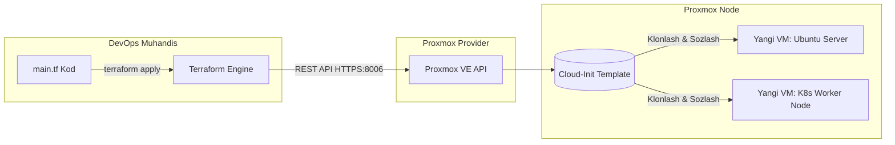

# Day 3: Proxmox Serverni Terraform Orqali Boshqarish (Lecture)

Ushbu darsda biz Terraformni On-Premise (o'zimizning jismoniy serverimiz yoki laboratoriyamiz)dagi mashhur **Proxmox VE (Virtual Environment)** gipervizoriga qanday ulashni va virtual mashinalarni (VM) kod orqali avtomatlashtirishni o'rganamiz.

---

## 🏢 1-Qism: Nega aynan Proxmox va Terraform?

Ko'pchilik Terraformni faqat AWS, Google Cloud yoki Azure kabi qimmat bulutlar uchun deb o'ylaydi. Ammo real kompaniyalarda:
- O'zlarining server xonalari (On-premise Datacenter);
- Arzonroq xususiy bulutlar (Private Cloud);
- Yoki ofisdagi/uydagi sinov serverlari (HomeLab) mavjud bo'ladi.

**Proxmox VE** — bu KVM va LXC texnologiyalariga asoslangan, bepul va kuchli ochiq kodli virtualizatsiya platformasi.  
Terraform + Proxmox tandemi orqali biz o'z serverimizda **"Xususiy AWS" (Private Cloud)** qurishimiz va bir tiyin ham bulutga to'lamasdan to'liq DevOps avtomatizatsiyasini amalga oshirishimiz mumkin!



---

## 🔌 2-Qism: Terraform Proxmox bilan qanday gaplashadi?

Proxmox o'zining to'liq funksional **REST API**siga ega (standart port: `8006`).  
Terraform esa maxsus **Proxmox Provider** orqali ushbu API'ga HTTPS so'rovlar yuboradi:

### Mashhur Proxmox Provayderlari:
1. **`Telmate/proxmox`** — Eng mashhur, ko'p yillik va hamjamiyatda eng ko'p qo'llaniladigan klassik provayder.
2. **`bpg/proxmox`** — Proxmox VE uchun yangi avlod rasmiy hamjamiyat provayderi (Go SDK asosida).

Biz darslarimizda eng ommabop va ko'p hujjatlashtirilgan **`Telmate/proxmox`** provayderidan foydalanamiz.

---

## 🔐 3-Qism: Xavfsizlik & Autentifikatsiya (API Token)

Hech qachon Terraform kodida Proxmoxning `root` parolini ochiq yozmaslik kerak! 
Buning o'rniga Proxmoxda maxsus **API Token** yaratiladi:

- **Foydalanuvchi:** `terraform-prov@pve` (maxsus cheklangan user)
- **Token ID:** `terraform-token`
- **Token Secret (UUID):** `xxxxxxxx-xxxx-xxxx-xxxx-xxxxxxxxxxxx`
- **Ruxsatlar (Role):** Faqat VM yaratish, tarmoq va xotirani boshqarish ruxsati (`PVEVMAdmin`, `PVEDatastoreUser`).

### TLS/SSL Sertifikati masalasi:
Ko'pincha lokal Proxmox serverlarida o'z-o'zidan imzolangan (*self-signed*) SSL sertifikat bo'ladi. Terraform xatolik bermasligi uchun:
```hcl
pm_tls_insecure = true
```
parametri yoqiladi.

---

## ⚡ 4-Qism: Cloud-Init Texnologiyasi (Tezkor VM yaratish siri)

Terraform orqali virtual mashina yaratishda noldan ISO o'rnatish (next, next bosib o'tirish) qilinmaydi! Buning o'rniga **Cloud-Init** ishlatiladi:

1. **VM Template (Andoza):** Proxmoxda bir marta Ubuntu Cloud Image yuklab olinadi va shablon (Template) qilib saqlanadi.
2. **Tezkor klonlash (Full / Linked Clone):** Terraform buyrug'i kelganda, ushbu shablondan **5-10 soniya ichida** yangi VM nusxalanadi.
3. **Cloud-Init orqali sozlash:** VM birinchi marta yoqilayotganda Cloud-Init unga avtomatik ravishda:
   - IP manzil beradi (DHCP yoki Static);
   - Foydalanuvchi (`ubuntu`) va parolini o'rnatadi;
   - Sizning ochiq SSH kalitingizni (`id_rsa.pub`) ichiga joylaydi.
   
Natijada siz kodni ishga tushirganingizdan 30 soniya o'tib, to'liq tayyor serverga SSH orqali parolsiz kira olasiz!

---

## 🧱 5-Qism: Proxmox Resurslarining Turlari

Terraform orqali Proxmoxda quyidagi resurslarni boshqarish mumkin:

| Resurs turi | Vazifasi | Misol |
| :--- | :--- | :--- |
| `proxmox_vm_qemu` | KVM to'liq virtual mashinalari (Ubuntu, Debian, Windows) | Veb-server, Kubernetes nodelari |
| `proxmox_lxc` | Yengil LXC Linux konteynerlari (Dockerga o'xshash, kam resurs yeydi) | DNS server, Nginx proxy |
| `proxmox_storage` | Disk xotiralari va NFS/ZFS saqlagichlar | Backup va ISO saqlash joyi |

---

## 📌 Xulosa
Proxmox + Terraform integratsiyasi — har bir DevOps muhandisiga o'z kompyuterida yoki ofis serverida real korporativ darajadagi avtomatlashtirishni his qilish imkonini beradi.

Endi buni amalda sozlash uchun **[Lab 03 (Amaliy Mashg'ulot)](../lab/README.md)**ga o'tamiz!
